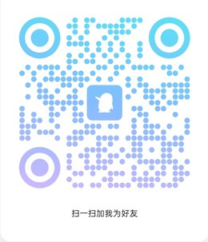

# 【持续更新】中小医院 LIS 系统选型与上线完整指南 2026｜检验科信息系统 价格、评审要求、避坑

<div align="center">

<b>LIS 系统源码出售 ｜ 定制开发 ｜ 仪器单工 / 双工接口开发 ｜ 支持过信创 ｜ 区域检验平台 ｜ 第三方实验室 LIMS ｜ 支持一切合作方式</b>

<b>QQ：2536811576　　微信：dynn2018</b>

</div>

---

> 本文更新于 **2026-11-18**，每月核对一次政策口径与价格区间。
> **声明**：本文非官方文件，政策条文以卫健委、CNAS 发布的原文为准。作者提供检验科信息系统（LIS）的部署与源码授权服务，文中利益相关已如实披露，结论请结合自身情况判断。

如果你正在为一家社区卫生服务中心、民营医院或二级医院找检验科系统，这篇文想帮你回答四个问题：

1. LIS / HIS / LIMS 到底各管什么，你是不是真的需要一套 LIS？
2. 市面上五条建设路径各自适合谁，坑在哪？
3. ISO 15189、电子病历 4 级、信创、等保——这四件事对系统到底要什么？
4. 大概要花多少钱，钱花在哪几块？

如果这篇对你有用，欢迎点一个 ⭐ 支持持续更新。

---

## 一、先分清：LIS / HIS / LIMS 到底各管什么

很多人第一步就走错——把 LIS 当成"HIS 里的一个检验模块"去买，或者把 LIMS 当成 LIS 的升级版。

| 系统 | 全称 | 管什么 | 谁在用 |
|---|---|---|---|
| **HIS** | 医院信息系统 | 全院的钱和流程：挂号、收费、住院、医嘱、药房、医保结算 | 全院 |
| **LIS** | 实验室信息系统 | 检验科内部：标本、结果、报告、质控、仪器 | 检验科 |
| **LIMS** | 实验室信息管理系统 | 更广的实验室管理：样品、人员、试剂、方法、环境、合规 | 第三方检测、疾控、食药检、科研实验室 |

**关键区别**：LIS 是"给医院检验科用的、围绕病人和报告转的"；LIMS 是"给独立实验室用的、围绕样品和合规转的"。医院场景下说 LIMS，多数时候指的是 LIS 的加强版。

它们之间的关系是接口，不是包含：

```
医生开检验申请（HIS） → 申请单送到检验科（接口） → 标本登记、上机、出结果（LIS）
   → 报告回传医生站（接口） → 收费、医保结算（HIS）
```

电子病历 4 级要求的"全院信息共享"，本质就是这条链路要通、且报告要能结构化落到医生站里。**这也是为什么 LIS 选型时，"接口能力"比"功能多少"更重要。**

> 详细版：[LIS、HIS、LIMS 有什么区别](docs/lis-his-lims-quxbie.md)

---

## 二、先认清你的实验室属于哪一类

不同体量的实验室，选型逻辑完全不同。先对号入座：

| 类型 | 典型特征 | 日标本量 | 预算区间（软件） | 选型要点 |
|---|---|---|---|---|
| 社区卫生服务中心 / 乡镇卫生院 | 1-2 名检验人员，1-3 台仪器 | 20-100 | 2-8 万 | 便宜、稳定、有人教、能本地部署 |
| 民营医院 / 二级医院 | 有独立检验科，5-20 人，5-20 台仪器 | 100-800 | 8-30 万 | 评审支持、接口能力、能否按需改 |
| 三级医院 | 专业组细分，流水线，多院区 | 800+ | 30 万起 | 并发、流水线对接、科研数据 |
| 第三方实验室 / 区域检验中心 | 多机构、多站点、样本物流 | 不定 | 按项目 | 多机构隔离、区域平台对接、报告互认 |

**一句话原则**：**别买超出你体量两级以上的系统。** 卫生院买三甲版，结果一定是"功能 80% 用不上、培训三个月、第二年不续维护"。

---

## 三、五条建设路径对比

| | 大厂成套 | 区域集成商 | 买源码自建 | 开源改造 | Excel 硬扛 |
|---|---|---|---|---|---|
| 首次投入 | 高 | 中 | 中高 | 低 | 0 |
| 上线周期 | 3-6 个月 | 1-2 个月 | 2-4 个月 | 2-6 周 | 立刻 |
| 能否定制 | 排期，贵 | 看人 | 完全自由 | 完全自由 | 完全自由 |
| 数据在哪 | 常在厂商云 | 本地 | 本地 | 本地 | 本地 |
| 出问题找谁 | 厂商工单 | 本地那个人 | 自己 / 源码方 | 社区 / 自己 | 自己 |
| 主要风险 | 贵、绑定 | 人跑了就没人管 | 养不起技术团队 | 没人维护、文档差 | 无留痕、评审过不了 |
| 适合谁 | 三级、集团 | 二级、民营 | 集成商、有 IT 的医院 | 预算极紧、有开发能力 | 日标本 < 30 且不上评审 |

下面逐条说。

---

## 四、路径一：大厂成套系统——什么情况下该买

**适合**：三级医院、集团医院、区域医共体牵头单位；有专职信息科；预算充足；更看重"出问题有人兜"而不是"能不能改"。

**优点**：功能全、并发稳、评审经验多、有大量同级医院案例可参考。

**缺点**（也是小机构最常抱怨的）：

- 报价按模块拆，接口、报表、合规模块另算，最终价常是首报的 1.5-2 倍；
- 定制要排期，改一个报表字段可能等一个月；
- 小机构没有议价权，服务响应优先级低。

**判断标准**：如果你医院的检验科有 5 个以上专业组、日标本过千、要接流水线——别省这个钱，买成套的。如果日标本不到 200，买成套大概率是浪费。

---

## 五、路径二：区域集成商——最常见，也最容易踩坑

这是中小医院最主流的选择：本地一家做 HIS 的公司，顺带代理或自研一套 LIS。

**优点**：响应快（人就在本地）、能一起把 HIS 接口打通、价格可谈、有事能上门。

**缺点**：

- **人员流动风险最高**。给你实施的那个人走了，系统就成孤儿——这是中小医院最常见的困境；
- 很多是"二开套壳"，底层版本老旧，遇到评审新要求改不动；
- 源码不在医院手里，换供应商时数据迁移是场灾难。

**避坑三条**：

1. 合同里写清**数据导出义务**：终止合作时必须提供完整结构化数据导出（含格式说明），不接受"只给 PDF"；
2. 写清**源码托管或源代码escrow**条款（达到一定条件可获取源码），谈不下来至少争取"关键接口文档交付"；
3. 问一句："你们这套 LIS 自己研发的还是代理的？代理的是哪家？"——代理的回答会影响你后面能不能直接找原厂。

---

## 六、路径三：买源码自建——什么条件下才划算

**适合**：集成商、有 1-2 名开发的信息科、想做自己品牌的区域服务商、有特殊流程必须改的专科医院。

**优点**：不被绑定、可按评审要求随便改、可以做成自己的产品对外交付、长期成本可控。

**缺点（必须提前知道）**：

- **买源码 ≠ 能维护源码**。没有 Java/Vue 基础，拿到源码也只是拿到一堆看不懂的文件；
- 升级要自己合，原厂出新版本你未必敢跟；
- 出故障时，责任边界容易扯皮。

**划算的临界点**：你未来 3 年至少要做 3 个以上项目，或有 1 名能读懂 Spring Boot 的开发。达不到，买标准版 + 定制服务更省钱。

**买源码时必须确认的 6 件事**：

1. 是**全量源码**还是"核心开源 + 商业模块闭源"？闭源模块有哪些？
2. 许可证是什么？AGPL / GPL 的衍生作品要开源，闭源商用需不需要另买授权？
3. 交付物清单：源码、数据库脚本、部署文档、接口文档、编译说明，缺一样都是坑；
4. 能否**去标**（换成自己品牌）？去标后能否二次分发？
5. 后续版本升级怎么算？免费给几个大版本？
6. 有没有**代码托管/ escrow** 或至少"原厂停止维护时可获取完整代码"的条款。

---

## 七、路径四：开源改造——预算最紧时的选择

**适合**：日标本量小、有开发能力、能接受"自己兜底"的机构；也适合集成商做底座。

**优点**：零许可证费用、可完全掌控、社区有现成方案。

**缺点**：开源 LIS 普遍"能跑但不好用"——中文界面缺失、国内仪器驱动少、评审要的报表没有、文档稀薄。**"免费"的成本最终会以人力形式付出去。**

**选开源方案时看四件事**：

1. 最近 6 个月有没有实质提交（不是只改 README）；
2. 许可证是 MIT/Apache（可闭源商用）还是 AGPL/GPL（衍生品要开源）；
3. 有没有 ASTM/HL7 仪器对接能力（没有就得自己写，这是最大的工作量）；
4. 有没有中文文档和本地化支持。

> 海外可选的有 OpenELIS Global（MPL-2.0，FHIR R4，社区较大但偏公共卫生场景）；国内可选项相对少，多数是"开源核心 + 商业版"模式。

---

## 八、路径五：Excel + 手工——什么时候还能撑

说实话，日标本量 30 份以下、只做血常规尿常规、不参加室间质评、不上任何评审的卫生室，Excel 加纸质登记还能撑。

但只要有下面任意一条，就该考虑了：

- 要出正式检验报告并盖章；
- 要参加室间质评（EQA）；
- 要过电子病历评级、等级评审、ISO 15189；
- 出现过"结果找不到是谁改的"这类纠纷；
- 仪器有 RS232 网口但还在手工抄结果。

**手工模式真正的问题不是慢，是没有留痕。** 出了事追不到人，这在医疗场景是硬伤。

---

## 九、选供应商的四条硬标准（附打分表）

不要只看演示。演示是精心准备过的。用这四条去问，答不上来的直接排除：

| 标准 | 怎么问 | 合格线 |
|---|---|---|
| **1. 接口能力** | "我们有一台 XX 型号生化仪，你们接过吗？没接过要多久？" | 能报出具体型号和协议（ASTM/HL7），没接过给得出工期 |
| **2. 评审支撑** | "电子病历 4 级，检验这块你们能提供哪些实证材料？" | 能说出具体实证项，而不是"我们能过" |
| **3. 交付边界** | "报价含不含接口？含几个？超出怎么算？第二年维护费多少？" | 报价单能写清不含项，维护费比例明确（通常 15-20%） |
| **4. 退出机制** | "如果我们以后换系统，数据怎么给我们？" | 合同里有数据导出条款，格式说得清 |

> 完整打分表（可直接打印带进评标会）：[LIS 选型评分表](docs/xuanxing-dafen-biao.md)

---

## 十、合规四件事：到底对系统要什么

先把最容易搞混的一点说清：

> **ISO 15189 认可的是"医学实验室"，电子病历分级评价的是"医院"，都不是评软件的。**
> 任何厂商说"我们的软件通过了 ISO 15189 认证"，这句话本身就是错的。正确说法是"系统支持 15189 认可相关条款的落地"。

### 10.1 ISO 15189（2022 版）

评的是实验室的质量和能力。落到系统上，要的是**全过程可追溯**：

- 标本从接收到处置的每个环节有时间戳和操作人；
- 结果与方法、设备、试剂批号绑定；
- 室内质控有失控处理和纠正措施记录；
- 室间质评有参加和评价记录；
- 报告修改保留原值、修改人、时间、理由；
- 危急值有通知时间、接收人、复读确认；
- 权限分级，谁能改什么说得清。

> 17 项自查清单（可打印）：[ISO 15189 系统自查清单](docs/iso15189-zicha-qingdan.md)

### 10.2 电子病历应用水平分级 4 级

4 级的核心是「全院信息共享，初级医疗决策支持」。对检验相关的要求（依据国家卫健委 2018 年发布的评价标准及北京等地实施细则）：

**局部要求**：通过数据接口方式实现所有系统（如 HIS、LIS）的数据交换。

**与检验直接相关的实证项**（病房检验报告，项目代号 01.03.4）：

1. 可获得检验科室报告数据；
2. 医师工作站中可查阅历史检验结果；
3. 查阅报告时能给出参考范围及异常标记；
4. 查看报告时可获得项目说明；
5. 检验报告与申请单可关联对应。

**现场核查会看**：报告是否集成在医生站内（**未集成、要另开一个系统看，判不合格**）；能否查 3 个月内、门诊+住院的历次结果；异常标识是否可见。

> 逐条对照表：[电子病历 4 级 检验相关实证项对照](docs/dianzibingli-4ji-jianyan-duizhao.md)

### 10.3 信创 / 国产化

公立医院采购的硬门槛，涉及四层：CPU（鲲鹏/飞腾/海光/龙芯）、操作系统（麒麟/统信 UOS）、数据库（达梦/人大金仓/openGauss）、中间件。

**要点**：厂商说"支持信创"时要追问**具体到哪一层、哪个版本、有没有适配报告**。"支持"和"已完成适配验证"是两回事。

### 10.4 等保 2.0 三级

评的是医院信息系统整体，LIS 要提供的是：账号权限分级、操作审计日志、数据传输与存储保护、备份恢复能力。这部分通常由院内 IT 和集成商一起落实，但系统本身要支持。

---

## 十一、上线流程实操（8 步）

1. **立项**：明确解决什么问题（不是"要上系统"，而是"报告出得太慢/评审缺材料/结果查不到"），定预算上限；
2. **梳理现状**：仪器型号清单（品牌+型号+接口类型）、现有 HIS 厂商、日标本量、检验项目数；
3. **选型**：3 家比价，要求现场演示**你自己的流程**（给一份真实项目清单让对方当场录入，别看他准备好的数据）；
4. **签合同**：写清交付清单、接口数量、验收标准、维护费、数据导出条款；
5. **接口对接**：HIS 侧谁改、LIS 侧谁改、测试环境什么时候给——这一步最容易拖，要定死时间和责任人；
6. **仪器联机**：逐台联调，记录每台的协议、波特率、结果格式；
7. **并行运行**：至少 2 周新旧并行，比对结果一致性；
8. **验收与培训**：按合同验收项逐条签字，培训要留签到和录屏（人员流动时能复用）。

**最容易出问题的两个环节**：接口对接（HIS 厂商不配合）和仪器联机（老仪器没说明书）。这两件事在签合同前就要问清楚谁负责。

---

## 十二、价格区间参考

> 以下是行业公开信息与从业经验整理的**参考区间**，不是报价承诺。实际价格受院区数、仪器台数、接口数量、是否需要现场实施影响，同规模医院之间差 2 倍很常见。

| 项目 | 参考区间 | 说明 |
|---|---|---|
| 卫生院/社区 LIS（软件） | 2-8 万 | 含基础流程 + 3-5 台仪器接口 |
| 二级/民营医院 LIS（软件） | 8-30 万 | 含质控、统计、HIS 接口 |
| 三级医院 LIS | 30 万起 | 常含流水线对接、多院区 |
| 单台仪器接口 | 2000-8000 元/台 | 常见机型便宜，罕见机型贵 |
| HIS 接口对接 | 1-5 万 | 取决于 HIS 厂商配合度，有的厂商收费很高 |
| 年维护费 | 合同额 15-20%/年 | 低于 10% 要警惕服务缩水 |
| 源码授权 | 标准版的 1.5-2.5 倍 | 看是否含去标、含几个项目 |
| 现场实施 | 2000-5000 元/人天 | 远程实施可省 |

**钱主要花在哪**：不是软件本身，是**接口**和**实施**。一套 5 万的软件，接口加实施做到 12 万很正常。谈价时盯住这两项，比砍软件价有用。

---

## 十三、常见问题

**Q：小医院真的需要 LIS 吗？**
日标本 30 份以上、或要出正式报告、或要参加室间质评、或要过任何评审——需要。否则手工还能撑，但要知道风险在哪（无留痕）。

**Q：能不能直接用 HIS 里的检验模块？**
能，但通常只覆盖"录结果、打报告"。质控、仪器联机、危急值闭环、评审留痕这些 HIS 模块一般做不到，最后还是要单独上 LIS。

**Q：LIS 能不能自己开发？**
可以，工作量比想象大：仪器协议解析（ASTM/HL7）、质控规则、报告模板引擎、权限审计，一套完整的做下来 6-12 人月。除非你有开发团队且要做产品，否则不划算。

**Q：买了系统，评审就一定能过吗？**
不能。评审看的是实验室质量体系的**运行**，系统只是提供记录能力。系统再好，质控不做、记录不填，一样过不了。

**Q：数据放在厂商云上安全吗？**
看合同。要求明确：数据所有权归医院、厂商不得用于其他用途、终止合作必须完整导出、有等保备案。多数中小医院还是倾向本地部署。

**Q：换系统时老数据怎么办？**
这是最容易被忽略的成本。签约前就要求对方提供"历史数据迁移方案"和报价，别等到换的时候才发现要另付几万。

---

## 十四、避坑清单

- ❌ 只看演示就签约——要求用**你自己的真实项目清单**当场录入
- ❌ 报价单只有总价——要求逐项拆开：软件、接口（含几台）、实施、培训、首年维护
- ❌ 合同没写数据导出条款——换系统时你会非常难受
- ❌ 相信"支持信创"四个字——要具体到数据库版本和适配报告
- ❌ 相信"能过 15189"——15189 评的是实验室，别被话术绕进去
- ❌ 接口数量没上限——超出部分单价能到软件价的 10%
- ❌ 不记录仪器型号和协议——联调时才发现老仪器没资料
- ❌ 让供应商同时做 HIS 和 LIS 且不给接口文档——绑定更深，后面换不动

---

## 十五、更新记录

| 日期 | 更新内容 |
|---|---|
| 2026-11-18 | 首版发布：五条路径对比、四类合规要求、价格区间、避坑清单 |
| （下次） | 补充各省电子病历评级细则差异、信创适配实测记录 |

---

## 十六、相关文档

**选型与评估**
- [LIS、HIS、LIMS 有什么区别](docs/lis-his-lims-quxbie.md)
- [LIS 选型评分表（可打印）](docs/xuanxing-dafen-biao.md)

**合规与评审**
- [ISO 15189 系统自查清单（17 项）](docs/iso15189-zicha-qingdan.md)
- [电子病历 4 级 检验相关实证项对照](docs/dianzibingli-4ji-jianyan-duizhao.md)

**合作**
- [贴牌、代理与项目合作说明](docs/hezuo-shuoming.md)

---

## 关于本仓库

**这里为什么不放源代码？**

因为这是一份选型指南，不是开源项目。放一堆半成品代码对读者没有价值，反而会让人误判"拿回去改改就能用"——医疗系统不是这么用的。

但"不放代码"不等于"没有技术内容"。判断一个团队是否真做过这套系统，看的是他能不能把细节讲清楚：ASTM 报文怎么解析、质控失控怎么拦截、报告修改怎么留痕。这些内容我会持续写进 `docs/`。

如果你需要**看系统实际长什么样**，可以：

- 预约 15 分钟远程演示（用演示数据，不含真实患者信息）
- 索取部署文档与接口说明样例
- 如果是集成商，可以聊贴牌与源码授权

演示与资料索取：微信 **dynn2018**（备注「演示」）　｜　QQ **2536811576**　｜　邮箱 **[2536811576@qq.com](mailto:2536811576@qq.com)**

---

## 寻找渠道商与合作伙伴

如果你做 HIS 但缺 LIS 模块、卖检验仪器想顺带把系统卖进去、或者手上有医院资源但缺产品——

**你负责市场，我们负责技术。**

- 你做医院关系、跑区域市场；我们出产品、出方案、出实施、兜技术支持
- 可以贴你的牌（客户看到的是你的人），可以授权源码，也可以按项目分成
- **不碰你报备的客户**：你报备过的客户，我们不报价、不签约
- 给你能直接用的东西：演示环境、报价模板、竞品话术、合规问答卡

合作方式与分润结构见 [贴牌、代理与项目合作说明](docs/hezuo-shuoming.md)。

### 联系方式

| 微信 | QQ |
|:---:|:---:|
|  |  |
| 微信：**dynn2018** | QQ：**2536811576** |

邮箱：**[2536811576@qq.com](mailto:2536811576@qq.com)**（发方案、报价单、招标文件请用邮件，便于留档；标题注明「LIS + 机构名」）

加好友请备注「LIS」，并直接说清三件事：你是哪类机构（医院 / 集成商 / 仪器代理）、手上有几家、现在卡在哪一步。这样第一句话就能聊到点上。

> 请勿在公开 Issue 中留下患者信息或机构敏感资料。

---

> 本仓库内容采用 CC BY-NC 4.0 许可：可自由转载、摘编，需署名并注明出处，不得用于商业培训或二次销售。
