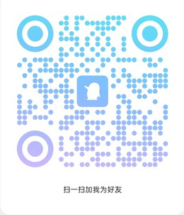

# 贴牌、代理与项目合作说明（对外公开版）

> 更新于 2026-11-18 ｜ 属于《[中小医院 LIS 选型与上线完整指南](../README.md)》系列
> 这份说明是公开的，因为我们希望来谈的人一开始就知道边界在哪，省掉双方的时间。

---

## 一、我们提供什么

一套面向中小医院的检验科信息系统（LIS）：标本登记、仪器联机、结果审核、报告打印、室内质控、统计、审计留痕。

技术上：Java / Spring Boot + Vue，私有化部署，支持离线安装，接口走 ASTM / HL7。

不是：HIS、不是医保结算系统、不是三甲医院级别的超大规模平台。**超出范围的场景我们会直接说不。**

---

## 二、适合跟谁合作

### ✅ 欢迎

| 类型 | 你的情况 | 你能得到什么 |
|---|---|---|
| **HIS 厂商 / 区域集成商** | 有医院客户和实施团队，检验这块是短板 | 贴你的牌，接口按你的规范改，差价归你 |
| **仪器代理商** | 卖生化/血球/免疫/POCT，客户常问"系统配哪家" | 仪器 + 系统一起报，多赚一份，交付我们兜 |
| **有医院资源的个人/公司** | 有关系、有项目信息，没产品没技术 | 你打通关系，方案报价演示实施我们全包，按合同额返点 |
| **有开发能力的集成商** | 想自己维护、自己改 | 源码授权，可去标，可二次开发 |

### ❌ 不适合

- **只做倒手、不参与交付的中间商**——项目烂尾的口碑算在我们头上，这个风险我们不接；
- **要源码但没有开发能力**——给了也维护不了，最后双方都难受（可以给你贴牌或分成）；
- **要求承诺"评审一定过"**——15189 认可的是实验室、电子病历分级评的是医院，没有任何软件能承诺这个；
- **要求独家但不愿承担任务量**——独家必须绑定年度项目数。

---

## 三、四种合作方式

| 方式 | 我们给 | 你做 | 结算 |
|---|---|---|---|
| **A 贴牌 OEM** | 可去标的成品、安装包、文档 | 你签单、你实施（我们二线支持） | 授权费 + 每院区费用，或按项目比例 |
| **B 源码授权** | 全量源码、数据库脚本、部署与接口文档 | 你自己开发、交付、维护 | 一次性授权费 + 可选升级服务 |
| **C 项目合作** | 方案、报价、演示、实施、验收全包 | 你出关系和需求对接 | 按合同额返点，回款后结算 |
| **D 区域代理** | 区域保护 + 渠道价 + 技术支持 | 你负责区域内销售与一线服务 | 渠道价拿货，差价归你 |

**空间参考**（具体按项目规模、交付分工核定，不是固定报价）：

- 贴牌授权：一次性授权费，或按项目比例分成（按项目规模与交付分工商定）
- 源码授权：高于标准版授权，含全量源码、数据库脚本与接口文档
- 项目合作：按合同额返点，回款后结算
- 区域代理：按渠道价拿货，差价归你

> 为什么是这个区间：你需要养销售、跑客户、垫差旅。低于 30% 的空间，渠道跑不动——这个账我们算得清，不会给你一个"看起来高但做不成"的政策。

---

## 四、区域与客户保护（我们最在意的一条）

| 规则 | 具体做法 |
|---|---|
| **报备制** | 你把客户名称提交给我们登记，**90 天内该客户归你**，我们不报价、不签约 |
| **客户主动找来** | 如果客户直接找到我们，我们转交给你跟进 |
| **撞单** | 双方都报备的，以首次有效接触时间为准 |
| **续约归属** | 老客户的维护续费归原渠道，不"摘桃子" |
| **区域独家** | 按地市授权，绑定年度任务量，未达标降为普通渠道 |

**写进协议的一句**：已报备客户，我们不直接报价、不直接签约。

---

## 五、我们提供给你的东西（不是产品手册，是能直接用的）

| 工具 | 用途 |
|---|---|
| 在线演示环境（30 天有效，含演示数据） | 客户要看，你不用装 |
| 5-8 分钟演示视频（可下载） | 微信直接发给客户 |
| 报价单模板（填参数自动算） | 你不会算价 |
| 竞品对比话术（一页纸） | 客户说"XX 更便宜"时怎么答 |
| 合规问答卡（15189 / 电子病历4级 / 信创 各 5 问 5 答） | 客户问专业问题你答不上 |
| 实施 SOP + 验收清单 | 你知道下一步干什么 |
| 高频故障处理手册（前 10 个） | 小事不用找我们 |

其中**竞品对比话术**和**合规问答卡**最实用——你懂关系，不一定懂检验；这两张纸补的就是这个缺口。

---

## 六、我们不做什么（先说清楚）

1. **不抢你已报备的客户**——这条是底线，一次就够毁掉所有口碑；
2. **不承诺评审通过**——只提供评审要的记录能力；
3. **不把源码卖给没有开发能力的人**——不是小气，是怕烂尾；
4. **不做超出范围的定制**——HIS 全院、医保结算、三甲级并发，这些我们会直接说做不了；
5. **不接受无限兜底的技术支持**——支持边界和响应时限会写进协议，写清楚了双方都省事。

---

## 七、怎么开始（三步，不用先签约）

**第一步：看演示**（30 分钟）
用演示数据走一遍：登记 → 上机 → 审核 → 出报告 → 质控。看完你觉得能卖，再往下谈。

**第二步：报备一个客户**
不用签约，先把你手上正在谈的那家报备过来。我们出方案和报价给你，你拿去报。

**第三步：做第一个项目**
第一个项目我们派工程师配合接口联调和部署。**接口跑不通，这个项目的授权费不收。**

---

## 八、联系方式

| 微信 | QQ |
|:---:|:---:|
|  |  |
| 微信：**dynn2018**（备注「合作」） | QQ：**2536811576** |

邮箱：**[2536811576@qq.com](mailto:2536811576@qq.com)**（发合作方案、客户报备、报价单用邮件，请附机构名与项目阶段）

> 我们不做电话陌拜，也不用企业微信加你进群发广告。你留言说清"你是哪类、手上有几家医院、现在卡在哪"，我们直接回有用的东西。
